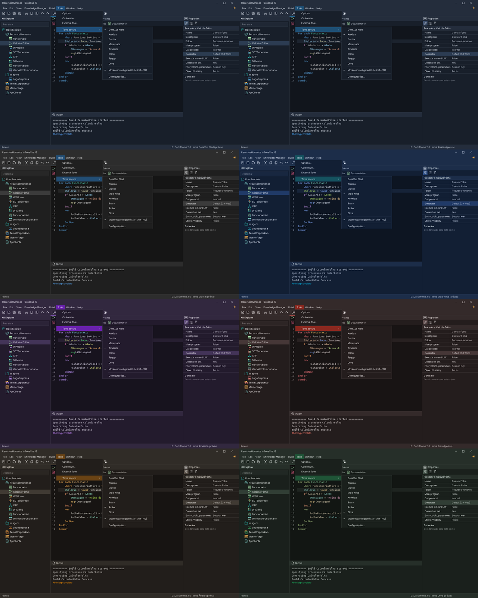

# GxDarkTheme — Dark Theme for the GeneXus 18 IDE

**English** · [Español](#español) · [Português](#português)


A dark theme for the **GeneXus 18** IDE: dark mode for the editors, KB Explorer, Properties, Output, toolbars, menus, grids and dialogs. It is a regular GeneXus extension (UI package) that runs in memory inside the IDE. It does not modify GeneXus files or your Knowledge Bases.



<sub>Theme previews generated by `tools/previa.py`.</sub>

## Features

- **8 themes:** GeneXus Next (default), Ardósia, Grafite, Meia-noite, Ametista, Brasa, Âmbar and Oliva.
- **GeneXus Next icons** (Mercury) in every theme, tinted to match the active one.
- **Live switching:** change the theme, or toggle light/dark, without restarting GeneXus.
- **Fully reversible:** light mode restores the original GeneXus look exactly.
- **Safe mode:** hold **Shift** while GeneXus starts to open it without the theme. If GeneXus fails to finish starting 3 times in a row, the extension falls back to light mode by itself.

## Requirements

- GeneXus 18 on Windows.
- Administrator rights to install the extension.

## Installation

1. **Close GeneXus.**
2. Run [`Setup-GxDarkTheme.exe`](Setup-GxDarkTheme.exe) and accept the administrator prompt.
3. Select your GeneXus 18 installations (the setup finds every `GeneXus18*` folder), choose the default theme and click **Install**.
4. Open GeneXus.

The setup also removes older versions (the previous Xpz.Dark and the old `GxDarkTheme.isl`) and keeps your Xpz.Dark theme choice.

> The setup is not code-signed, so Windows SmartScreen or your antivirus may warn about it. If you prefer, build it from source (see below).

## Usage

| Action | How |
|---|---|
| Toggle light/dark | Sun/moon button at the right of the menu bar, or **Ctrl+Shift+F12** |
| Change theme | **Tools > Tema escuro**, or right-click the sun/moon button |
| Settings | **Tools > Tema escuro > Configurações...** |
| Skip the theme once | Hold **Shift** while GeneXus starts |
| Uninstall | Windows **Settings > Apps > Installed apps > GxDarkTheme > Uninstall** (close GeneXus first) |

Settings are stored in `%APPDATA%\GeneXus\GeneXus\18\GxDarkTheme.settings`. The log is written to `%TEMP%\GxDarkTheme.log`; please attach it when you report an area that is still light.

The extension menus and the setup are currently in Portuguese (pt-BR).

## What it does not do

- It does not modify GeneXus or third-party binaries, nor your Knowledge Bases.
- It does not change Windows colors.
- Everything happens in memory while GeneXus is open.

## Build from source

Requires GeneXus 18 installed (its DLLs are used only as references):

```powershell
cd GeneXus-DarkMode
powershell -ExecutionPolicy Bypass -File scripts\Build.ps1
```

Output goes to `GeneXus-DarkMode\dist\`. See [GeneXus-DarkMode/README.md](GeneXus-DarkMode/README.md) for build options, tests and project structure (in Portuguese).

## Repository layout

| Folder | Content |
|---|---|
| [`GeneXus-DarkMode/`](GeneXus-DarkMode/) | Source code of GxDarkTheme 2.0 (current version) |
| [`gx-dark/`](gx-dark/) | Xpz.Dark, one of the two projects merged into 2.0 (history) |

## Contributing

Bug reports and pull requests are welcome. For a visual issue, please include a screenshot, the theme in use, your GeneXus 18 upgrade and `%TEMP%\GxDarkTheme.log`.

## License and credits

- Code: **MIT** ([LICENSE](LICENSE)), © 2026 Gabriel Turman ([@Turman005](https://github.com/Turman005)) and Filipe Castro ([@itsFilipe](https://github.com/itsFilipe)).
- Icons: [@genexus/mercury](https://www.npmjs.com/package/@genexus/mercury) 1.5.0, Apache-2.0, with modifications. See [THIRD-PARTY-NOTICES.md](THIRD-PARTY-NOTICES.md).

This is an independent community project, **not affiliated with GeneXus S.A.** GeneXus and Mercury are trademarks of GeneXus S.A.

---

## Español

Tema oscuro para el IDE de **GeneXus 18**: modo oscuro para los editores, KB Explorer, Properties, Output, barras de herramientas, menús, grillas y diálogos. Es una extensión común de GeneXus (paquete de interfaz) que funciona en memoria dentro del IDE. No modifica archivos de GeneXus ni sus Knowledge Bases.

### Características

- **8 temas:** GeneXus Next (predeterminado), Ardósia, Grafite, Meia-noite, Ametista, Brasa, Âmbar y Oliva.
- **Íconos de GeneXus Next** (Mercury) en todos los temas, con el tono del tema activo.
- **Cambio en vivo:** cambie el tema, o alterne entre claro y oscuro, sin reiniciar GeneXus.
- **Totalmente reversible:** el modo claro restaura exactamente el aspecto original de GeneXus.
- **Modo seguro:** mantenga **Shift** presionado mientras GeneXus inicia para abrirlo sin el tema. Si GeneXus no termina de iniciar 3 veces seguidas, la extensión vuelve sola al modo claro.

### Requisitos

- GeneXus 18 en Windows.
- Permisos de administrador para instalar la extensión.

### Instalación

1. **Cierre GeneXus.**
2. Ejecute [`Setup-GxDarkTheme.exe`](Setup-GxDarkTheme.exe) y acepte la solicitud de administrador.
3. Seleccione sus instalaciones de GeneXus 18 (el instalador encuentra todas las carpetas `GeneXus18*`), elija el tema predeterminado y haga clic en **Instalar**.
4. Abra GeneXus.

El instalador también elimina versiones anteriores (el antiguo Xpz.Dark y el antiguo `GxDarkTheme.isl`) y conserva el tema que usaba en Xpz.Dark.

> El instalador no tiene firma digital, por lo que Windows SmartScreen o su antivirus pueden mostrar una advertencia. Si lo prefiere, compílelo desde el código fuente (ver abajo).

### Uso

| Acción | Cómo |
|---|---|
| Alternar claro/oscuro | Botón sol/luna a la derecha de la barra de menús, o **Ctrl+Shift+F12** |
| Cambiar de tema | **Tools > Tema escuro**, o clic derecho en el botón sol/luna |
| Configuración | **Tools > Tema escuro > Configurações...** |
| Abrir sin el tema una vez | Mantenga **Shift** presionado mientras GeneXus inicia |
| Desinstalar | **Configuración de Windows > Aplicaciones > Aplicaciones instaladas > GxDarkTheme > Desinstalar** (cierre GeneXus antes) |

La configuración se guarda en `%APPDATA%\GeneXus\GeneXus\18\GxDarkTheme.settings`. El log se escribe en `%TEMP%\GxDarkTheme.log`; adjúntelo al reportar un área que siga clara.

Por ahora, los menús de la extensión y el instalador están en portugués (pt-BR).

### Lo que no hace

- No modifica binarios de GeneXus ni de terceros, ni sus Knowledge Bases.
- No cambia los colores de Windows.
- Todo ocurre en memoria mientras GeneXus está abierto.

### Compilar desde el código fuente

Requiere GeneXus 18 instalado (sus DLLs se usan solo como referencia):

```powershell
cd GeneXus-DarkMode
powershell -ExecutionPolicy Bypass -File scripts\Build.ps1
```

El resultado queda en `GeneXus-DarkMode\dist\`. Las opciones de compilación, las pruebas y la estructura del proyecto están en [GeneXus-DarkMode/README.md](GeneXus-DarkMode/README.md) (en portugués).

### Contribuir

Los reportes de errores y los pull requests son bienvenidos. Para un problema visual, incluya una captura de pantalla, el tema en uso, su upgrade de GeneXus 18 y el archivo `%TEMP%\GxDarkTheme.log`.

### Licencia y créditos

- Código: **MIT** ([LICENSE](LICENSE)), © 2026 Gabriel Turman ([@Turman005](https://github.com/Turman005)) y Filipe Castro ([@itsFilipe](https://github.com/itsFilipe)).
- Íconos: [@genexus/mercury](https://www.npmjs.com/package/@genexus/mercury) 1.5.0, Apache-2.0, con modificaciones. Ver [THIRD-PARTY-NOTICES.md](THIRD-PARTY-NOTICES.md).

Proyecto comunitario independiente, **sin vínculo con GeneXus S.A.** GeneXus y Mercury son marcas de GeneXus S.A.

---

## Português

Tema escuro para a IDE do **GeneXus 18**: modo escuro nos editores, KB Explorer, Properties, Output, barras de ferramentas, menus, grades e diálogos. É uma extensão comum do GeneXus (pacote de interface) que roda em memória dentro da IDE. Não altera arquivos do GeneXus nem as suas KBs.

### Recursos

- **8 temas:** GeneXus Next (padrão), Ardósia, Grafite, Meia-noite, Ametista, Brasa, Âmbar e Oliva.
- **Ícones do GeneXus Next** (Mercury) em todos os temas, com a matiz do tema ativo.
- **Troca ao vivo:** troque o tema, ou alterne entre claro e escuro, sem reiniciar o GeneXus.
- **Totalmente reversível:** o modo claro devolve exatamente o visual original do GeneXus.
- **Modo seguro:** segure **Shift** enquanto o GeneXus abre para abri-lo sem o tema. Se o GeneXus não terminar de abrir 3 vezes seguidas, a extensão volta sozinha ao modo claro.

### Requisitos

- GeneXus 18 no Windows.
- Permissão de administrador para instalar a extensão.

### Instalação

1. **Feche o GeneXus.**
2. Execute o [`Setup-GxDarkTheme.exe`](Setup-GxDarkTheme.exe) e aceite o pedido de administrador.
3. Escolha as instalações do GeneXus 18 (o instalador encontra todas as pastas `GeneXus18*`), o tema padrão e clique em **Instalar**.
4. Abra o GeneXus.

O instalador também remove as versões antigas (o Xpz.Dark e o `GxDarkTheme.isl` antigos) e aproveita o tema que você usava no Xpz.Dark.

> O instalador não tem assinatura digital, então o SmartScreen do Windows ou o seu antivírus podem avisar. Se preferir, compile a partir do código-fonte (veja abaixo).

### Uso

| Ação | Como |
|---|---|
| Alternar claro/escuro | Botão sol/lua à direita da barra de menus, ou **Ctrl+Shift+F12** |
| Trocar o tema | **Tools > Tema escuro**, ou botão direito no sol/lua |
| Configurações | **Tools > Tema escuro > Configurações...** |
| Abrir sem o tema uma vez | Segure **Shift** enquanto o GeneXus abre |
| Desinstalar | **Configurações do Windows > Aplicativos > Aplicativos instalados > GxDarkTheme > Desinstalar** (feche o GeneXus antes) |

A configuração fica em `%APPDATA%\GeneXus\GeneXus\18\GxDarkTheme.settings`. O log fica em `%TEMP%\GxDarkTheme.log`; mande esse arquivo ao relatar uma área que continue clara.

Guia completo do usuário: [GeneXus-DarkMode/LEIA-ME.md](GeneXus-DarkMode/LEIA-ME.md).

### O que a extensão não faz

- Não altera binários do GeneXus nem de terceiros, nem as suas KBs.
- Não altera as cores do Windows.
- Tudo acontece em memória, enquanto o GeneXus está aberto.

### Compilar a partir do código-fonte

Exige o GeneXus 18 instalado (as DLLs dele servem só de referência):

```powershell
cd GeneXus-DarkMode
powershell -ExecutionPolicy Bypass -File scripts\Build.ps1
```

O resultado fica em `GeneXus-DarkMode\dist\`. Opções de build, testes e estrutura do projeto: [GeneXus-DarkMode/README.md](GeneXus-DarkMode/README.md).

### Contribuir

Relatos de erro e pull requests são bem-vindos. Para um problema visual, mande um print, o tema em uso, o upgrade do seu GeneXus 18 e o arquivo `%TEMP%\GxDarkTheme.log`.

### Licença e créditos

- Código: **MIT** ([LICENSE](LICENSE)), © 2026 Gabriel Turman ([@Turman005](https://github.com/Turman005)) e Filipe Castro ([@itsFilipe](https://github.com/itsFilipe)).
- Ícones: [@genexus/mercury](https://www.npmjs.com/package/@genexus/mercury) 1.5.0, Apache-2.0, com modificações. Veja [THIRD-PARTY-NOTICES.md](THIRD-PARTY-NOTICES.md).

Projeto comunitário independente, **sem vínculo com a GeneXus S.A.** GeneXus e Mercury são marcas da GeneXus S.A.
